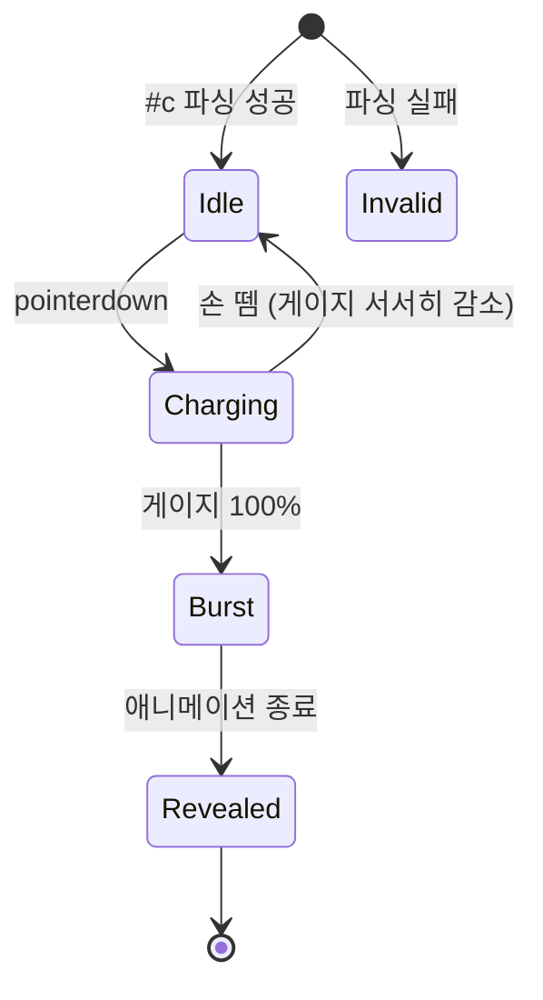

 🐉 Message_app

> 서울과기대 마스코트 '테크뇽'이 말하기 어려운 한마디를 대신 품고 가는 링크형 메시지 앱

받는 사람이 화면을 **꾹 눌러 테크뇽을 응원해 줘야** 메시지가 열립니다.
서버도 DB도 없이, 메시지는 오직 링크 안에만 존재합니다.

> ⚠️ **캐릭터 저작권 고지**
> '테크뇽' 캐릭터의 저작권 및 2차 저작물에 대한 권리는 서울과학기술대학교에 있습니다.
> 이 레포지토리는 **캐릭터 이미지를 포함하지 않으며**, 공개 배포 전 서울과학기술대학교 홍보실의 사용 승인을 받습니다.
> 공식 에셋: [서울과기대 마스코트 페이지](https://www.seoultech.ac.kr/intro/symbol/mascot/intro) · [매뉴얼(관리지침)](https://www.seoultech.ac.kr/intro/symbol/mascot/manual)

---

## 1. 핵심 컨셉

| 구분 | 흐름 |
|---|---|
| 보내는 사람 | 메시지 입력 → 링크 생성 → 메신저로 공유 |
| 받는 사람 | 링크 열기 → 편지를 품은 테크뇽 → 꾹 누르기(응원 게이지) → 퐁! → 메시지 공개 |
| 저장 방식 | URL fragment(`#c=`)에 인코딩, 서버 저장 없음 |
| 배포 | 정적 사이트 (Vercel) |

## 2. 설계 근거 (Design Rationale)

| 설계 | 메커니즘 | 기대 효과 |
|---|---|---|
| 캐릭터를 통한 간접 전달 | 발신자가 직접 말하는 대신 '테크뇽이 품고 온 말'로 프레이밍 | 발신 시점의 심리적 노출 부담 감소 |
| Hold-to-reveal | 수신자가 능동적으로 누르고 기다려야 열림 | 읽기 전 완충 구간 확보 → 준비된 상태에서 메시지 확인 |
| 미리보기에 메시지 비노출 | fragment는 서버로 전송되지 않아 OG 크롤러가 읽을 수 없음 | 단톡방·푸시 알림에 내용이 새지 않음 |
| 무저장 (Stateless) | 메시지가 URL에만 존재 | 운영 비용 0, 서버 측 개인정보 보관 0 |

## 3. 동작 원리

### 3.1 링크 포맷

```
https://<domain>/#c=<base64url(JSON)>
```

| 필드 | 타입 | 필수 | 설명 |
|---|---|---|---|
| `v` | number | ✅ | 페이로드 스키마 버전 (하위 호환용) |
| `m` | string | ✅ | 메시지 본문 (최대 200자) |

```json
{"v":1,"m":"사실 그때 고마웠어"}
```

```
#c=eyJ2IjoxLCJtIjoi7IKs7IukIOq3uOuVjCDqs6Drp4jsm6DslrQifQ
```

### 3.2 인코딩 파이프라인

```
message
  → JSON.stringify
  → UTF-8 bytes (TextEncoder)
  → base64
  → base64url (+ → -, / → _, '=' 제거)
```

디코딩은 역순입니다. `btoa()`는 Latin-1만 처리하므로 한글은 반드시 `TextEncoder`를 거쳐야 합니다.

### 3.3 길이 예산

| 항목 | 값 |
|---|---|
| 한글 1자 | UTF-8 3 bytes → base64 약 4자 |
| 200자 메시지 페이로드 | 614 bytes → fragment 819자 |
| 전체 URL (도메인 포함) | 약 0.9KB |

메신저마다 URL 길이 처리 방식이 달라 보수적으로 **200자**를 상한으로 둡니다.

### 3.4 수신 화면 상태 머신



| 상태 | 테크뇽 포즈 (공식 응용 동작에서 매핑) | 화면 연출 |
|---|---|---|
| Idle | `pose-idle` | "테크뇽이 편지를 품고 왔어요. 꾹 눌러 응원해 주세요" |
| Charging | `pose-idle` 유지 | 흔들림(translate/rotate), 게이지 진행, 지원 기기 진동 |
| Burst | `pose-cheer` | 퐁! 파티클 이펙트 (캐릭터와 분리된 자체 에셋) |
| Revealed | `pose-letter` | 메시지 카드 표시 |
| Invalid | `pose-confused` | "링크가 손상됐어요" + 새로 쓰기 버튼 |

## 4. 캐릭터 에셋 정책

공식 매뉴얼은 캐릭터의 무단 복제·배포·변형과 지정 색상 변경을 금지합니다. 이를 코드 레벨 규칙으로 옮기면 다음과 같습니다.

| 매뉴얼 조항 | 구현 규칙 |
|---|---|
| 사전 승인 없는 복제·배포 금지 | 에셋 파일은 `.gitignore` 처리, 레포·빌드 산출물에 미포함 (승인 전) |
| 왜곡·변형 금지 | 이미지 자체는 수정하지 않음. 모션은 `transform`(이동·회전·균일 스케일)과 `opacity`만 사용 |
| 지정 색상 준수 | `filter`(hue-rotate, saturate 등) 적용 금지, 다크 모드에서도 원본 색 유지 |
| 포즈 다양화 | 새 포즈를 그리지 않고 공식 응용 동작 이미지 교체로만 표현 |

```gitignore
# 공식 마스코트 에셋 (저작권: 서울과학기술대학교, 승인 전 커밋 금지)
public/assets/character/*
!public/assets/character/.gitkeep
```

로컬 개발 시에는 공식 페이지에서 PNG를 내려받아 `public/assets/character/`에 넣습니다. 파일이 없으면 `placeholder.svg`(단순 도형)로 자동 대체되어 개발 흐름이 끊기지 않습니다.

## 5. 기술 스택

| 영역 | 선택 | 이유 |
|---|---|---|
| 빌드 | Vite | 정적 산출물, 빠른 HMR |
| 언어 | TypeScript (Vanilla) | 화면 2개 규모 → 프레임워크 불필요, 번들 최소화 |
| 애니메이션 | CSS keyframes + Web Animations API | 외부 의존성 0, transform 기반으로 에셋 정책 준수 |
| 입력 | Pointer Events + `requestAnimationFrame` | 마우스·터치·펜 단일 처리 |
| 테스트 | Vitest | codec 왕복 단위 테스트 |
| 배포 | Vercel | 정적 호스팅, PR 프리뷰 |

## 6. 디렉터리 구조

```
Message_app/
├── index.html
├── public/
│   ├── assets/
│   │   ├── character/            # 공식 테크뇽 PNG (gitignore, 로컬 전용)
│   │   │   └── .gitkeep
│   │   └── effects/              # 자체 제작 이펙트 (파티클, 효과선)
│   └── og/default.png            # 링크 미리보기 이미지 (메시지 미포함)
├── src/
│   ├── main.ts                   # 진입점: #c 유무로 compose / reveal 분기
│   ├── codec/
│   │   ├── base64url.ts          # UTF-8 ↔ base64url
│   │   └── payload.ts            # 스키마 검증 + 버전 마이그레이션
│   ├── features/
│   │   ├── compose/
│   │   │   └── ComposeView.ts    # 입력, 글자 수 제한, 링크 복사·공유
│   │   └── reveal/
│   │       ├── RevealView.ts
│   │       ├── holdGesture.ts    # 응원 게이지 (pointer events + rAF)
│   │       └── stateMachine.ts   # Idle → Charging → Burst → Revealed
│   ├── character/
│   │   ├── poses.ts              # 상태 → 에셋 경로 매핑 + fallback 처리
│   │   └── placeholder.svg       # 에셋 부재 시 대체 도형
│   └── styles/
│       └── main.css
├── tests/
│   └── codec.test.ts
├── .gitignore
└── README.md
```

## 7. 시작하기

```bash
git clone https://github.com/<username>/Message_app.git
cd Message_app
npm install

# 공식 페이지에서 테크뇽 PNG를 받아 public/assets/character/ 에 배치 (선택)

npm run dev      # http://localhost:5173
npm run test
npm run build    # dist/ 생성
```

## 8. 로드맵

| 버전 | 범위 | 완료 기준 |
|---|---|---|
| v0.1 | codec + compose + reveal (placeholder) | 링크 인코딩·디코딩 왕복 테스트 통과 |
| v0.2 | 홀드 게이지, 상태 머신, transform 모션 | iOS Safari / Android Chrome 동작 확인 |
| v0.3 | 공식 포즈 매핑, Web Share API, 복사 피드백 | 로컬에서 전체 플로우 시연 가능 |
| **Gate** | **서울과기대 홍보실 사용 승인** | **승인 전 공개 배포·에셋 커밋 금지** |
| v0.4 | Vercel 공개 배포, OG 이미지 | 카카오톡 링크 미리보기 확인 |
| v0.5 | 접근성 (키보드 홀드, `prefers-reduced-motion`) | Lighthouse Accessibility ≥ 95 |
| v1.0 | 페이로드 v2: 보낸 사람(`f`), 테마(`t`) | v1 링크 하위 호환 유지 |

## 9. 보안 · 개인정보 고지

- 메시지는 **암호화되지 않습니다.** base64url은 인코딩일 뿐이며, 링크를 가진 누구나 원문을 볼 수 있습니다.
- fragment는 서버로 전송되지 않지만, 링크 자체는 메신저 서버와 브라우저 기록에 남습니다.
- 비밀번호, 계좌번호 등 민감한 정보는 보내지 마세요.
- 검토 중: Web Crypto API(PBKDF2 + AES-GCM) 기반 비밀번호 잠금 — 링크와 비밀번호를 다른 채널로 전달하는 방식

## 10. License

| 대상 | 라이선스 |
|---|---|
| 소스 코드 | MIT |
| 테크뇽 캐릭터 | © 서울과학기술대학교, 레포 미포함 · MIT 적용 대상 아님 |
